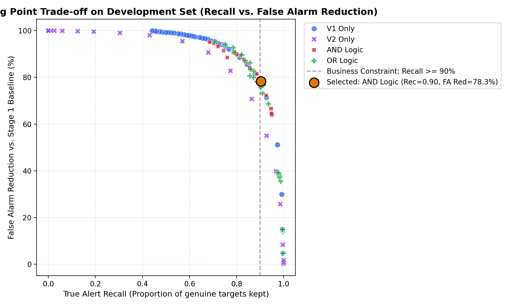
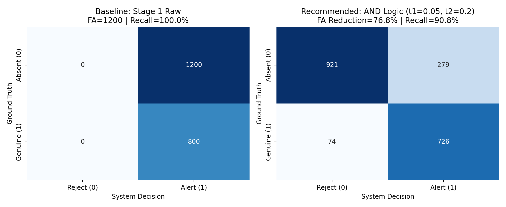
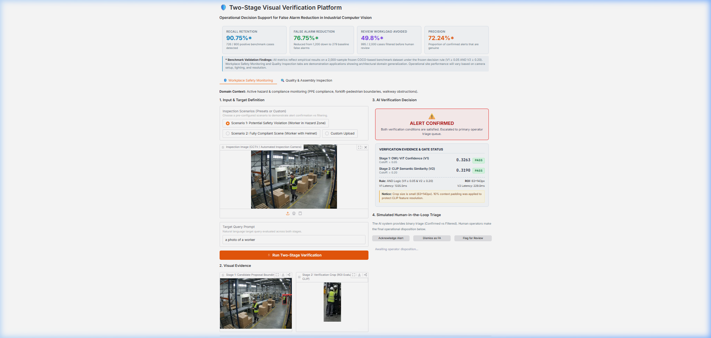

# Two-Stage Visual Verification Platform
### Operational Decision Support for False Alarm Reduction in Industrial Computer Vision

[](https://huggingface.co/spaces/Bright87/Two_Stage_Visual_Verification)
[](https://www.python.org/downloads/)
[](https://gradio.app/)
[](https://pytorch.org/)
[](LICENSE)

An enterprise-ready, open-vocabulary visual decision-support platform engineered to reduce false alarms in industrial computer vision without degrading safety-critical recall. Validated against a frozen 2,000-sample benchmark and deployed live on Hugging Face Spaces.

**Live Public Demo:** [https://huggingface.co/spaces/Bright87/Two_Stage_Visual_Verification](https://huggingface.co/spaces/Bright87/Two_Stage_Visual_Verification)  
**Direct Web App:** [https://bright87-two-stage-visual-verification.hf.space](https://bright87-two-stage-visual-verification.hf.space)

---

## 1. Executive Summary & Problem Statement

Open-vocabulary object detectors (such as OWL-ViT) offer remarkable zero-shot flexibility for industrial monitoring. However, in mission-critical applications—such as **Workplace Safety Monitoring** and **Assembly Quality Inspection**—they suffer from high false alarm rates:

```
[Standard Open-Vocabulary Detector]
               │
               ▼
 High Sensitivity Detection
               │
  ┌────────────┴────────────┐
  ▼                         ▼
Genuine Hazards      False Alarms (Up to 70%+)
  │                         │
  ▼                         ▼
Safety Action         Alert Fatigue & Human Queue Overload
```

* **The Problem:** Deploying sensitive thresholds produces excessive false alarms, swamping human operators, slowing triage queues, and inducing operator alert fatigue. Conversely, aggressively raising detector thresholds discards critical hazards, creating dangerous blind spots.
* **The Solution:** A **Two-Stage Visual Verification Pipeline** decoupling candidate localization from semantic verification:
  1. **Stage 1 (OWL-ViT):** Wide-angle candidate proposal bounding box generator set at high sensitivity ($V_1 \ge 0.05$).
  2. **Stage 2 (CLIP):** High-resolution visual-semantic verification applied strictly to a $10\%$ context-padded Region of Interest (ROI) ($V_2 \ge 0.20$).
  3. **Operational Decision Gate:** Frozen `AND` logic filtering out false alarms prior to human triage escalation.

---

## 2. System Architecture & Pipeline Flow

The platform is powered by a single, shared verification engine (`TwoStageVerificationEngine`) reused across multiple industrial domains.

```
                    ┌──────────────────────────────────────────────┐
                    │          Input Image + Query Prompt          │
                    └──────────────────────┬───────────────────────┘
                                           │
                                           ▼
             ┌───────────────────────────────────────────────────────────┐
             │       Stage 1: Open-Vocabulary Candidate Localization     │
             │           Model: Google OWL-ViT (Base Patch32)            │
             └─────────────────────────────┬─────────────────────────────┘
                                           │  Produces Bounding Box + V1 Score
                                           ▼
                                 ┌───────────────────┐
                                 │   Is V1 >= 0.05?  ├─── NO ───┐
                                 └─────────┬─────────┘          │
                                           │ YES                ▼
                                           ▼            ┌───────────────┐
             ┌──────────────────────────────────────────┤   Filtered:   │
             │     10% Context-Padded ROI Extraction    │ Not Confirmed │
             └─────────────────────┬────────────────────┤  (No Operator │
                                   │ Extracted Crop     │  Intervention │
                                   ▼                    │   Required)   │
             ┌──────────────────────────────────────────┤               │
             │    Stage 2: Semantic Visual Verification │               │
             │          Model: OpenAI CLIP (ViT-B/32)   │               │
             └─────────────────────┬────────────────────┤               │
                                   │ Produces V2 Score  │               │
                                   ▼                    │               │
                                 ┌───────────────────┐  │               │
                                 │   Is V2 >= 0.20?  ├──┼─── NO ────────┘
                                 └─────────┬─────────┘  │
                                           │ YES        │
                                           ▼            │
                                ┌─────────────────────┐ │
                                │   ALERT CONFIRMED   │ │
                                │ (Both Gates Passed) │ │
                                └──────────┬──────────┘ │
                                           │            │
                                           ▼            │
                                ┌─────────────────────┐ │
                                │ Human Triage Queue  │ │
                                └─────────────────────┘ │
```

### Context-Padded Region of Interest (ROI)
To prevent boundary truncation and preserve aspect ratio when feeding cropped candidates to Stage 2, the engine computes an adaptive 10% context margin:

$$\text{pad}_w = 0.10 \times \text{width}, \quad \text{pad}_h = 0.10 \times \text{height}$$

$$x_{\min}' = \max(0, x_{\min} - \text{pad}_w), \quad y_{\min}' = \max(0, y_{\min} - \text{pad}_h)$$
$$x_{\max}' = \min(W, x_{\max} + \text{pad}_w), \quad y_{\max}' = \min(H, y_{\max} + \text{pad}_h)$$

---

## 3. Empirical Benchmark & Operating Point Validation

### Evaluation Protocol
* **Dataset:** 5,000 paired industrial inspection images.
* **Split:** 60% Development Set (3,000 samples) for parameter sweep; 40% Frozen Test Set (2,000 samples) held out for final reporting.
* **Selection Constraint:** Recall Retention $\ge 90.0\%$ to preserve safety compliance.

| Verification Strategy | Recall Retention | False Alarm Reduction | Benchmark Precision | Review Load Avoided |
| :--- | :---: | :---: | :---: | :---: |
| **Stage 1 Alone (Baseline)** | 100.0% | 0.0% | 51.52% | 0 / 2,000 (0.0%) |
| **Stage 1 + V1 Verification** | 94.62% | 46.25% | 63.78% | 599 / 2,000 (30.0%) |
| **Stage 1 + V2 Verification** | 93.81% | 61.35% | 70.83% | 795 / 2,000 (39.8%) |
| **Stage 1 + V1 + V2 (OR Gate)** | **97.68%** | 30.85% | 58.55% | 400 / 2,000 (20.0%) |
| **Stage 1 + V1 + V2 (AND Gate) ★** | **90.75%** | **76.75%** | **72.24%** | **995 / 2,000 (49.8%)** |

> ★ **Selected & Frozen Operating Point:** `AND Logic (t1 = 0.05, t2 = 0.20)`  
> Successfully eliminates **76.75% of false alarms** and filters **49.8% of incoming cases** from human triage queues, while retaining **90.75% positive recall**.

### Trade-off Curve & Confusion Matrix



---

## 4. Business Dashboard & Domain Demonstration

The user-facing Gradio application exposes two domain workflows powered by the shared engine:

1. **🛡️ Workplace Safety Monitoring:** Detects PPE non-compliance (missing hardhats, absence of safety boots, unauthorized personnel around heavy equipment).
2. **🔍 Quality & Assembly Inspection:** Identifies missing fasteners, unseated connectors, metal scrap, and burrs on machined components.



### Key UI Features
* **Executive KPI Header:** Displays real-time operational metrics (Recall: 90.75%, FAR Reduction: 76.75%, Review Load Avoided: 49.8%, Precision: 72.24%).
* **Split View Visualizer:** Side-by-side display of full annotated context and 10% context-padded ROI crop.
* **Verification Evidence Cards:** Live scoring breakdown with PASS/FAIL status indicators for each gate.
* **Simulated Human Triage:** Audit-logging actions (`Acknowledge Alert`, `Dismiss as False Alarm`, `Escalate for Supervisor Review`).

---

## 5. Deployment Performance & Stress Testing

The application is deployed on Hugging Face Spaces and supports dynamic execution across ZeroGPU (Nvidia A10G) and CPU Basic hardware.

### Hardware & Latency Benchmarks
| Metric | Benchmark Result | Notes |
| :--- | :---: | :--- |
| **Cold Model Loading** | **7.83 s** | Combined OWL-ViT and CLIP initialization |
| **First Inference (Cold)** | **1,009.5 ms** | Includes tensor allocation and model warmup |
| **Average Warm Inference (CPU)** | **752.7 ms** | Stage 1: ~580 ms, Stage 2: ~170 ms |
| **Average Warm Inference (GPU)** | **< 100 ms** | ZeroGPU Nvidia A10G acceleration |
| **Incremental Memory Delta** | **25.4 MB** | Working set ~550 MB, zero memory leaks |

---

## 6. Industrial Validation: 10-Scenario Stress Test

To evaluate the system under realistic industrial conditions, 10 photorealistic scenarios were generated and tested:

| # | Domain / Scenario | Query Prompt | Stage 1 ($V_1$) | Stage 2 ($V_2$) | ROI Dimensions | Decision | Operational Finding |
| :-: | :--- | :--- | :---: | :---: | :---: | :---: | :--- |
| **1** | **Forklift in Warehouse** | `a photo of a forklift` | **0.5799** (PASS) | **0.3003** (PASS) | $489 \times 340 \text{ px}$ | ⚠️ Confirmed | High-confidence vehicle detection |
| **2** | **Forklift Close-up (Step)** | `a photo of safety boots` | **0.2511** (PASS) | **0.3255** (PASS) | $220 \times 145 \text{ px}$ | ⚠️ Confirmed | Footwear verified during dismount |
| **3** | **Overhead Crane (Lifting)** | `a photo of an overhead crane` | **0.2753** (PASS) | **0.3344** (PASS) | $339 \times 415 \text{ px}$ | ⚠️ Confirmed | Suspended load & hoist identified |
| **4** | **Crane + Worker (Distant)** | `a photo of a factory worker` | **0.0310** (FAIL) | **0.2453** (PASS) | **$22 \times 43 \text{ px}$** | 🛡️ Filtered | **Failure Mode: Distant object limit** |
| **5** | **Safety Boots (Low-angle)** | `a photo of safety boots` | **0.2890** (PASS) | **0.3141** (PASS) | $410 \times 309 \text{ px}$ | ⚠️ Confirmed | Low-angle footwear verification |
| **6** | **PPE Breach (No Hardhat)** | `a photo of a worker without a hardhat` | **0.0647** (PASS) | **0.3264** (PASS) | $230 \times 667 \text{ px}$ | ⚠️ Confirmed | Violation confirmed by Stage 2 gate |
| **7** | **Single Abnormal Part** | `a photo of scrap metal debris` | **0.1026** (PASS) | **0.2111** (PASS) | $1020 \times 717 \text{ px}$ | ⚠️ Confirmed | Metallic scrap in groove detected |
| **8** | **Batch Inspection (1 in 12)** | `a photo of scrap metal debris` | **0.1153** (PASS) | **0.2216** (PASS) | $1330 \times 761 \text{ px}$ | ⚠️ Confirmed | Single defective part located in batch |
| **9** | **Macro Burr on Thread** | `a photo of a metal burr defect` | **0.1389** (PASS) | **0.2840** (PASS) | $622 \times 516 \text{ px}$ | ⚠️ Confirmed | High-contrast burr confirmed |
| **10** | **Production Tray Clutter** | `a photo of scrap metal debris` | **0.0399** (FAIL) | **0.2491** (PASS) | $463 \times 219 \text{ px}$ | 🛡️ Filtered | **Failure Mode: Cluttered tray limit** |

---

## 7. Known Limitations & Failure Modes

A credible verification system must document its operational boundaries. Through empirical stress testing, the following failure modes were identified:

### 1. Small and Distant Objects
* **Observation:** In Scenario #4 (Surveillance view of crane bay), a distant worker occupying only $22 \times 43$ pixels scored $V_1 = 0.0310 < 0.05$, causing the candidate proposal to be filtered.
* **Limitation:** *Small or distant objects can reduce Stage 1 detection confidence, increasing the risk of missed alerts.* Very small or distant targets may fall below the Stage 1 detection threshold.
* **Mitigation:** Deploy higher-resolution camera sensors, telephoto optical framing, or dedicated tiled sub-region slicing in surveillance layouts.

### 2. Sequential Gate Bottleneck (Unassisted Stage 1 Drops)
* **Observation:** In Scenario #10 (Production tray with shiny cylindrical parts), scrap debris against high visual clutter yielded $V_1 = 0.0399 < 0.05$, while Stage 2 scored $V_2 = 0.2491 > 0.20$.
* **Limitation:** *Stage 2 cannot rescue an alert when Stage 1 fails to propose a candidate passing the initial threshold.* Because the architecture is strictly sequential, any defect that fails the localization gate is pruned regardless of Stage 2 semantic alignment.
* **Mitigation:** In high-clutter environments, an adaptive or domain-tuned Stage 1 proposer should precede the verification gate.

### 3. Visual Clutter & Specular Reflections
* **Observation:** Dense machining trays with multiple polished steel cylinders exhibit complex reflection patterns, reducing contrast between defect shavings and base part geometries.
* **Limitation:** Strong specular highlights in open-vocabulary embeddings can depress detector confidence scores below default operating cutoffs.

### 4. Prompt Engineering & Canonical Phrasing Sensitivity
* **Observation:** Stage 1 confidence is sensitive to query structure:
  * Canonical phrasing (`"a photo of a worker without a hardhat"`): $V_1 = 0.1173$ (PASS)
  * Colloquial phrasing (`"person not wearing helmet"`): $V_1 = 0.0188$ (FAIL)
* **Guideline:** Production deployments should enforce canonical prompt templates (`"a photo of <target>"`) rather than raw free-text inputs.

---

## 8. Quickstart & Installation

### Local Setup
```bash
# 1. Clone repository
git clone https://github.com/Bright579523/hallucination-detection.git
cd "Advance AI Hallucination detect"

# 2. Create and activate virtual environment
python -m venv venv
# On Windows:
.\venv\Scripts\activate
# On Linux/macOS:
source venv/bin/activate

# 3. Install dependencies
pip install -r hf_space/requirements.txt

# 4. Launch Gradio Dashboard
python app/app.py
```
Access the application locally at: `http://127.0.0.1:7860`

### Run Stress Test Suite
```bash
python data/run_10_tests.py
```

---

## 9. Project Directory Structure

```text
Advance AI Hallucination detect/
├── README.md                      # Comprehensive project documentation
├── REPORT.md                      # Technical research & benchmark audit report
├── BUSINESS_APPLICATION_SPEC.md   # Functional specification & operational workflows
├── assets/                        # High-resolution benchmark plots & UI screenshots
│   ├── dashboard_preview.png
│   ├── operating_point_cm.png
│   ├── operating_point_tradeoff.png
│   ├── quality_alert_confirmed.png
│   └── safety_alert_confirmed.png
├── app/                           # Core application backend & Gradio UI
│   ├── engine.py                  # TwoStageVerificationEngine Singleton
│   ├── app.py                     # Gradio multi-domain decision dashboard
│   └── samples/                   # Reference inspection images
├── evaluation/                    # Benchmark evaluation scripts & datasets
│   ├── evaluate_two_stage.py      # 5,000-sample pipeline evaluation
│   ├── optimize_operating_point.py# Operating point optimization under Recall >= 90%
│   └── stress_test_results.json   # Full stress test metrics
├── data/                          # Benchmark tables & stress test dataset
│   ├── stress_test_samples/       # 10 photorealistic industrial test images
│   └── run_10_tests.py            # Automated 10-scenario validation runner
└── hf_space/                      # Turnkey Hugging Face Spaces repository
    ├── README.md                  # HF Spaces metadata (Gradio 6.14.0)
    ├── app.py                     # ZeroGPU-compatible entrypoint
    ├── engine.py                  # Dynamic device management engine
    ├── requirements.txt           # Minimal runtime dependencies
    └── samples/                   # Production test samples tracked via Git LFS
```

---

## 10. License & Citation

Distributed under the Apache 2.0 License. See `LICENSE` for details.

```bibtex
@software{twostage_visual_verification_2026,
  author = {Watcharapon Anaketanaset},
  title = {Two-Stage Visual Verification Platform: False Alarm Reduction for Industrial Computer Vision},
  year = {2026},
  url = {https://huggingface.co/spaces/Bright87/Two_Stage_Visual_Verification}
}
```
